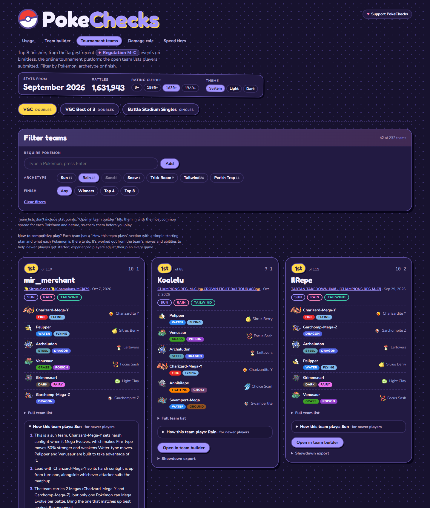
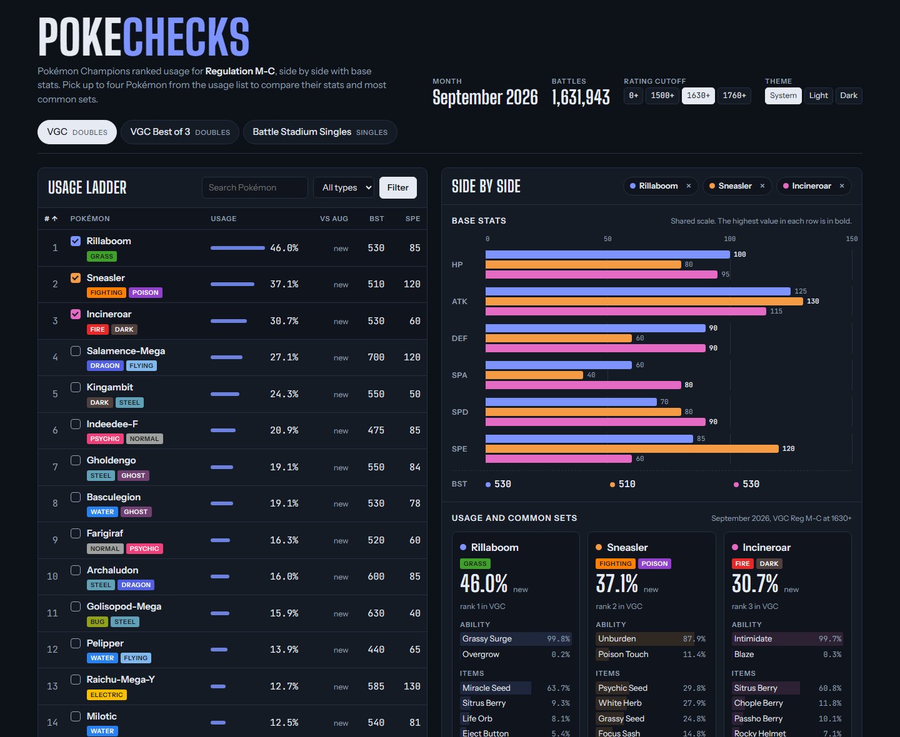
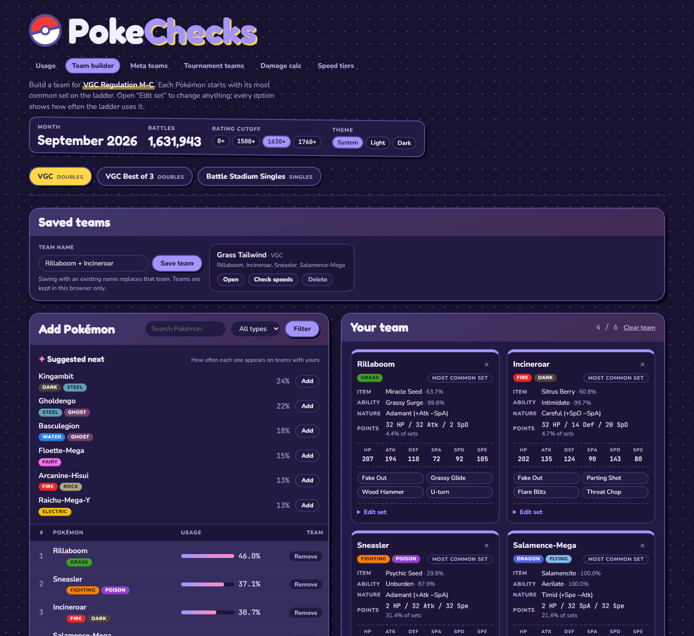
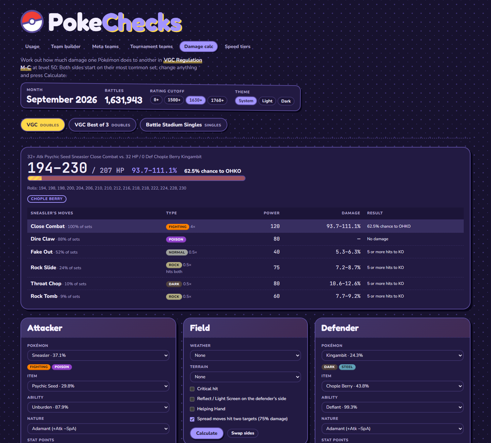
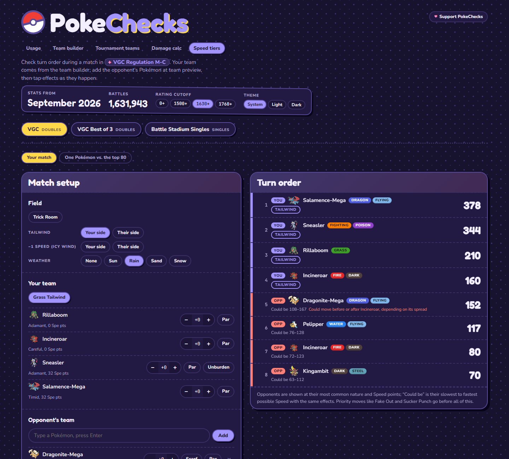
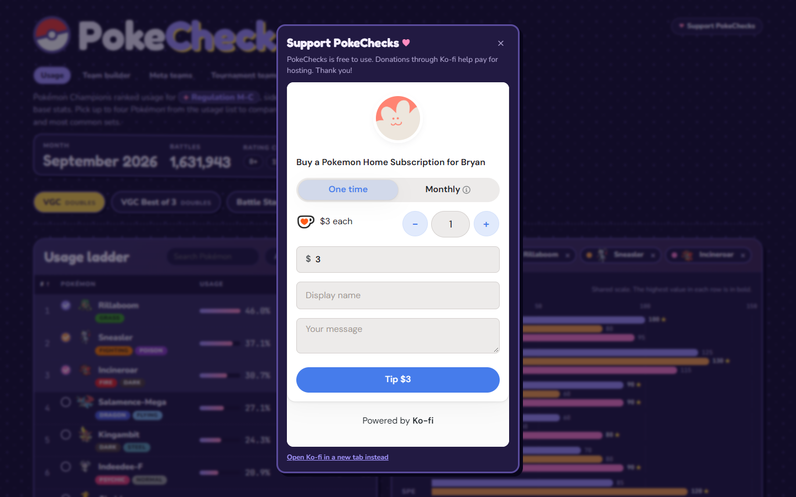

# PokeChecks

**Live site: [pokechecks.onrender.com](https://pokechecks.onrender.com)** · Free to use; if it
helps you, you can [support it on Ko-fi](https://ko-fi.com/pokechecks) to cover hosting.

Pokémon Champions ranked usage, side by side with base stats. Shows the newest Champions
regulation that Smogon has published stats for (currently Regulation M-C) across VGC,
VGC Best of 3 and Battle Stadium Singles.

Written in Rust (edition 2024, Rust 1.99) with Axum and Maud. Pages are rendered on the
server and need no JavaScript. A System / Light / Dark switch in the header lets each
visitor pick a theme, remembered in a cookie; System follows the device setting. The look
is playful on purpose: polka-dot paper in light mode, a starry night in dark mode, sticker
panels, bubbly type, a CSS Poké Ball logo, a mini sprite beside every Pokémon's name and
an icon beside every item, and each move tagged with its type.
Animations switch off for visitors who prefer reduced motion.

A "Support PokeChecks" button in the header (and a link in the footer) opens Ko-fi's donation
form in a small pop-up, so visitors can donate without leaving the page. It uses the
browser's built-in popover, still with no JavaScript, and Ko-fi isn't contacted until someone
opens it.

Every tournament team has a "How this team plays" section for newer players:
a short starting plan (the team's main idea, a simple lead, which Pokémon to Mega Evolve,
who does the damage) and what each Pokémon is there to do. It's worked out from the team's
own moves, abilities and items, so it stays accurate as the teams change.



The pages share one URL, so links keep the format, comparison and team:

- **Usage:** the ladder, sortable and filterable, with up to four Pokémon compared side by
  side on base stats, items, moves and teammates.
- **Team builder:** pick up to six Pokémon (one per species). Each starts on its most common
  set, with items following the item clause. "Edit set" changes the item, ability, moves,
  nature and stat points; every option shows its ladder usage, common spreads are one click
  away, and custom stat points are checked against the Champions limits (32 per stat, 66
  total). The page shows level 50 stats, type matchups (counting abilities like Levitate),
  Speed order, teammate suggestions, and a Showdown / Poképaste export.
- **Damage calc:** level 50 damage between any two Pokémon in the format, using Champions
  stats and Pokémon Showdown's Gen 9 damage formula and rounding. Both sides start on their
  most common set; items, abilities, natures, stat points, stat stages, weather, terrain,
  critical hits, screens, Helping Hand and doubles spread damage can all be changed. Shows
  the damage range, every roll and the KO chance, plus the attacker's other common moves.
- **Speed tiers:** built for checking turn order mid-match. Your team comes from the team
  builder or a saved team, at its real natures, Speed points and items; add the opponent's
  Pokémon at team preview by typing part of a name. Both teams are sorted into one turn
  order (reversed under Trick Room), with each opponent at its most common spread plus its
  possible range, and close calls marked. Tailwind, Icy Wind, weather (for Swift Swim and
  similar), Trick Room, Speed stages, paralysis, Choice Scarf and Unburden are one-tap
  toggles. A second tab compares one Pokémon with the top 80.
- **Saved teams:** the team builder can save up to 12 teams, kept in your browser as
  cookies (no account, nothing stored on the server), and open them later or on the
  Speed tiers page.
- **Tournament teams:** the top 8 open team lists from the 30 largest recent events
  (32 or more players, roughly the last three weeks) for the current regulation on
  [Limitless](https://play.limitlesstcg.com/tournaments?game=VGC), up to 240 teams, best
  finishes first. Filters work like Pikalytics': require one or more Pokémon (a species such
  as Charizard also finds its Megas), pick archetypes (Sun, Rain, Sand, Snow, Trick Room,
  Tailwind, Perish Trap, each showing how many teams it would leave), or a finish (winners,
  top 4, top 8). Filters are part of the link, so a filtered list can be shared. Any team
  opens in the builder; team lists have no stat points, so the builder fills them in from
  the most common spread for each Pokémon and nature. Old `/teams` links (the meta teams
  page this replaced) redirect here.

The header says which month's stats you're looking at, such as "Stats from September 2026":
the month the battles were played. Smogon publishes each month's stats in the first days of
the next month, so it trails the calendar by about a month.

A link PokeChecks can't read, such as one edited to give a setting twice
(`/speed?add=Kingambit&add=Pelipper`), opens a friendly "This link doesn't look quite right"
page instead of an error. It names the repeated setting and links to the same page started
fresh, or to the usage page.

## Privacy and security

- Nothing is stored on the server. Your theme and saved teams live in cookies in your own
  browser, and there are no accounts, analytics or ads.
- Pages make no requests to other sites: the fonts and Pokémon sprites are served by
  PokeChecks itself. The only exception is Ko-fi's donation form, loaded when you open the
  support pop-up.
- The `/api/v1` data the mobile app uses is public and read-only, so any site may read it.
  It carries no cookies or saved teams.
- Every response carries a strict Content Security Policy that allows no scripts at all, and
  PokeChecks can't be shown inside another site's frame. Saved teams can only be added or
  deleted from PokeChecks itself, not by forms on other sites.

## Screenshots

All shown in the dark theme.

**Usage**



**Team builder**, with a saved team



**Damage calc**



**Speed tiers**, mid-match



**Donation pop-up**, opened from the "Support PokeChecks" button



## Run

```
cargo run
```

Then open http://127.0.0.1:3000. Optional settings, as environment variables:

- `PORT`: the port to listen on (default 3000).
- `HOST`: the address to listen on (default `127.0.0.1`, this computer only; `0.0.0.0`
  accepts connections from other machines).
- `SUPPORT_URL`: a support page starting with `https://`. A Ko-fi page
  (`https://ko-fi.com/name`) opens in the donation pop-up; any other page is a plain link.
  Without it, the support button and link are hidden.

On first start it downloads Pokémon Showdown's Pokédex data and icon sheet, then fetches Smogon usage files
as each format and rating cutoff is first viewed. It checks for a newer month or regulation
every six hours, so a new regulation (such as M-D) appears without code changes.

## How the data stays current

While the server runs, it refreshes everything itself:

- **Usage stats:** checks Smogon every 6 hours. Smogon publishes each month's stats in the
  first days of the next month; earlier months are dropped from memory when a new one
  appears.
- **Tournament teams:** loads when the server starts, then checks Limitless every 3 hours,
  downloading at most 4 events' standings at a time. The regulation comes from
  Limitless's own format list, so a new regulation's events show up as soon as they're
  played instead of waiting a month for Smogon.
- **Pokédex and sprites:** reloads Showdown's data and icon sheet every 24 hours (retrying
  hourly if it fails), so new Pokémon, forms and Megas appear without a restart.

Refreshes happen on the first visit after each interval, so that visit can take a few
seconds longer.

## Code layout

The repo is a Cargo workspace. `crates/core` (`pokechecks-core`) holds the data types and
battle logic: the Pokédex, usage stats, tournament team lists, the damage calc, team
building and game plans. It does no networking and renders no HTML, so the server and the
mobile app (through WebAssembly) can share it. The server in `src/` downloads the data and
renders the pages.

`crates/wasm` (`pokechecks-wasm`) wraps the core for the app. The app hands its downloaded
`/api/v1` data to an `Engine` and asks it for damage calcs, team stats, teammate
suggestions, game plans and tournament team imports, all on the device. To build it you need
the `wasm32-unknown-unknown` target and the matching `wasm-bindgen` command:

```
rustup target add wasm32-unknown-unknown
cargo install wasm-bindgen-cli --version 0.2.129 --locked
cargo build -p pokechecks-wasm --target wasm32-unknown-unknown --profile wasm
wasm-bindgen target/wasm32-unknown-unknown/wasm/pokechecks_wasm.wasm --target web --out-dir pkg
```

That writes `pkg/pokechecks_wasm.js`, its TypeScript types, and a 555 KB `.wasm` file
(146 KB compressed).

## API for the mobile app

The mobile app downloads its data from a small read-only JSON API and keeps a copy, so it
works offline:

| Endpoint | What it returns | Compressed size |
| --- | --- | --- |
| `GET /api/v1/manifest` | The stats month and each format's regulation and rating cutoffs | under 1 KB |
| `GET /api/v1/dex` | Showdown's Pokédex, moves, names and icon positions | about 105 KB |
| `GET /api/v1/usage/{format}?cutoff=1630` | Ranked usage with common sets and teammates; `format` is `vgc`, `vgc-bo3` or `bss`, and the cutoff defaults to the format's usual one | 200–450 KB |
| `GET /api/v1/tournaments` | Top teams from recent large events | about 25 KB |
| `GET /api/v1/sprites/pokemon.png`, `/items.png` | The icon sheets | 390 KB, 90 KB |

Every response, the icon sheets included, has an `ETag`; the app sends it back in `If-None-Match` and gets a
`304 Not Modified` when nothing changed. Responses are compressed (Brotli or gzip), and any
site or app may read them (`Access-Control-Allow-Origin: *`), since they're public and
read-only. The rest of the site still can't be read by other sites. Errors come back as
`{"error": "..."}`, with 404 for an unknown format or cutoff and 502 when Smogon or
Limitless can't be reached. `manifest.schema` goes up if a response changes in a way older
app versions can't read.

Usage percentages are kept to 4 decimal places and teammate shares to 0.01%, for the
website too. Pages show one decimal place, so nothing visible changes, but the usage file
for VGC shrinks from 4.2 MB to 2.4 MB.

## Mobile app

`app/` is the PokeChecks app for Android and iOS: React and TypeScript, built with Vite
and wrapped with Capacitor 7 (app ID `com.pokechecks.app`). It downloads the `/api/v1`
data once, keeps it on the phone, and runs the battle logic through the WebAssembly engine,
so it works offline. When it opens, or comes back to the foreground, it asks the server for
anything newer using the saved ETags and downloads only what changed.

So far it has:

- **Usage:** the ladder for each format, with each Pokémon's common items, abilities,
  moves, spread and teammates, and an "Add to team" button.
- **Team builder:** up to six Pokémon on their most common sets, following the item
  clause and the one-form-per-species rule. "Edit set" opens a sheet for the item,
  ability, moves and nature (each showing its ladder usage), stat point steppers held to
  the Champions limits, and one-tap common spreads. Below the team: level 50 stats, type
  matchups with problem types highlighted, Speed order, teammate suggestions in the
  picker, and a Showdown export with Copy and Share. The team in each format is kept on
  the phone, and any number of teams can be saved by name.
- **Damage calc:** both sides open on their most common sets; tap either Pokémon to change
  it, "Edit set" for its item, ability, nature and stat points, and steppers for stat
  stages and burn. The result shows the description line, damage range, KO chance, an HP
  bar and all 16 rolls, with every other common attack's range on its move button.
  Weather, terrain, critical hits, Helping Hand, screens and spread hits are one tap. A
  team member's "Calc" button opens it as the attacker on its exact set.
- **About**, with the fan-app disclaimer.

Tournament teams and speed tiers come next.

The styles include plain fallbacks for `color-mix()` and `dvh`, so phones with an older
Android System WebView (before Chrome 111) still get a working layout.

Set up once (Node 22, plus the Rust tools from "Code layout" above):

```
cd app
npm install
```

Then:

- `npm run dev` runs it in a browser at http://localhost:5190, using the live site's data.
  To use a local server instead, put `VITE_API_BASE=http://127.0.0.1:3000` in
  `app/.env.development.local`.
- `npm run build` builds the WebAssembly engine and the app into `app/dist`.
- `npm run cap:android` builds, copies the app into `app/android` and opens Android Studio.
- `npm run cap:ios` does the same for Xcode, on a Mac.

The iOS project uses Swift Package Manager, not CocoaPods. `cap sync` on Windows writes
backslash paths into `ios/App/CapApp-SPM/Package.swift`, so `scripts/fix-spm-paths.mjs` runs
after every sync and turns them into forward slashes.

The icon and splash screens are drawn by `scripts/generate-assets.mjs`: a check mark over
rising usage bars on a sticker tile, in the website's colours. It isn't a Poké Ball, since
store icons are where trademark complaints start. After changing the script, run
`npm run assets` to regenerate `app/assets/` and every Android and iOS size. The native
splash stays up until the app has drawn its first screen, so there's no blank flash.

GitHub Actions builds a debug APK on every pull request (download it from the run's
Artifacts to install on an Android phone) and an iOS Simulator build when the app or the
Rust crates change.

## Test

```
cargo test --workspace
cargo clippy --workspace --all-targets -- -D warnings
```

GitHub Actions runs these, plus `cargo fmt --check`, the WebAssembly build (failing if the
`.wasm` file passes 1 MB), the app's typecheck and build, and a Docker build of the image Render deploys, on every pull request and push to `main` (`.github/workflows/ci.yml`).

## Load test

`python scripts/loadtest.py` simulates visitors using a local server at the same time: each
has their own cookies, clicks around, uses the damage calc and speed tiers, and saves and
deletes teams. It reports failures, response times per page, and whether any visitor ever
saw another's saved teams, and exits with an error if anything failed.

```
python scripts/loadtest.py 50 --seconds 120 --think 1 3
python scripts/loadtest.py --burst 60
```

The first runs 50 visitors pausing 1–3 seconds between clicks; `--think 0 0` runs them flat
out. `--burst` sends requests for every format and cutoff at once, to check a cold server
downloads each file only once. To mimic Render Starter, run the Docker image with
`--cpus=0.5 --memory=512m` and pass `--base http://127.0.0.1:10000`. It only targets local
servers unless given `--allow-remote`, so it can't slow the live site down by accident.

## Deploy

The repo is set up for [Render](https://render.com), which redeploys on every push to `main`:

1. In the Render dashboard, choose **New → Blueprint** and pick this repository. Render reads
   `render.yaml` and creates a `pokechecks` web service on the Starter plan, built from the
   `Dockerfile`.
2. When it asks for `SUPPORT_URL`, paste your Ko-fi or GitHub Sponsors page to show the
   "Support PokeChecks" button and footer link, or leave it empty to hide them. You can change
   it later under the service's **Environment** settings.
3. Wait for the first build (several minutes, as it compiles in release mode). The site is then
   at `https://pokechecks.onrender.com`, or similar if that name is taken.

Avoid the Free plan: it sleeps when idle, and each wake-up downloads the Pokédex and usage
stats again, so the first visit after a quiet spell is slow.

The image works on any host that runs Docker. It listens on `0.0.0.0` at `PORT` (10000 by
default) and answers health checks at `/healthz`. Outside Docker, set `HOST=0.0.0.0` to accept
connections from other machines.

## Screenshots for this README

With the server running, `python scripts/screenshots.py` retakes every image in `docs/`. It
needs Python 3 and Chrome or Edge, with no other packages. Set `CHROME` if the browser isn't
found. Start the server with `SUPPORT_URL=https://ko-fi.com/pokechecks` so the screenshots show
the support button like the live site, and so it can capture the donation pop-up.

## Data sources

- Usage: [Smogon usage stats](https://www.smogon.com/stats/), the monthly "chaos" files.
- Base stats, types, and move, item and ability names: [Pokémon Showdown](https://play.pokemonshowdown.com/data/).
- Fonts: Fredoka, Nunito and JetBrains Mono, served from `assets/fonts` under the SIL Open
  Font License (see [assets/fonts/OFL.txt](assets/fonts/OFL.txt)).
- Pokémon and item sprites: Pokémon Showdown's icon sheets, downloaded with the Pokédex and
  served by PokeChecks itself.
- Tournament teams: the [Limitless public API](https://docs.limitlesstcg.com/developer.html).

## License

MIT. See [LICENSE](LICENSE).

PokeChecks is a free fan project, not affiliated with Nintendo, Game Freak, Creatures or
The Pokémon Company. Pokémon and its names and images belong to them.
