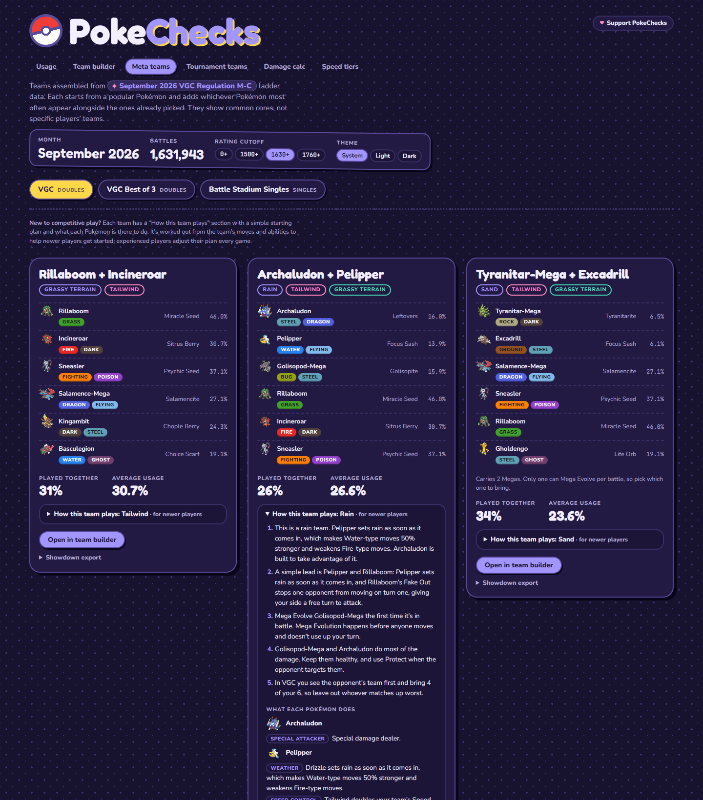

# PokeChecks

Pokémon Champions ranked usage, side by side with base stats. Shows the newest Champions
regulation that Smogon has published stats for (currently Regulation M-C) across VGC,
VGC Best of 3 and Battle Stadium Singles.

Written in Rust (edition 2024, Rust 1.99) with Axum and Maud. Pages are rendered on the
server and need no JavaScript. A System / Light / Dark switch in the header lets each
visitor pick a theme, remembered in a cookie; System follows the device setting. The look
is playful on purpose: polka-dot paper in light mode, a starry night in dark mode, sticker
panels, bubbly type, a CSS Poké Ball logo, and a mini sprite beside every Pokémon's name.
Animations switch off for visitors who prefer reduced motion.

Every meta team and tournament team has a "How this team plays" section for newer players:
a short starting plan (the team's main idea, a simple lead, which Pokémon to Mega Evolve,
who does the damage) and what each Pokémon is there to do. It's worked out from the team's
own moves, abilities and items, so it stays accurate as the teams change.



The pages share one URL, so links keep the format, comparison and team:

- **Usage:** the ladder, sortable and filterable, with up to four Pokémon compared side by
  side on base stats, items, moves and teammates.
- **Team builder:** pick up to six Pokémon (one per species). Each starts on its most common
  set, with items following the item clause. "Edit set" changes the item, ability, moves,
  nature and stat points; every option shows its ladder usage, common spreads are one click
  away, and custom stat points are checked against the Champions limits (32 per stat, 66
  total). The page shows level 50 stats, type matchups (counting abilities like Levitate),
  Speed order, teammate suggestions, and a Showdown / Poképaste export.
- **Meta teams:** teams assembled from teammate statistics. Each starts from a popular
  Pokémon and adds whichever Pokémon most often appear alongside the ones already picked,
  without mixing weathers or terrains. They show common cores, not specific players' teams.
- **Damage calc:** level 50 damage between any two Pokémon in the format, using Champions
  stats and Pokémon Showdown's Gen 9 damage formula and rounding. Both sides start on their
  most common set; items, abilities, natures, stat points, stat stages, weather, terrain,
  critical hits, screens, Helping Hand and doubles spread damage can all be changed. Shows
  the damage range, every roll and the KO chance, plus the attacker's other common moves.
- **Speed tiers:** built for checking turn order mid-match. Your team comes from the team
  builder or a saved team, at its real natures, Speed points and items; add the opponent's
  Pokémon at team preview by typing part of a name. Both teams are sorted into one turn
  order (reversed under Trick Room), with each opponent at its most common spread plus its
  possible range, and close calls marked. Tailwind, Icy Wind, weather (for Swift Swim and
  similar), Trick Room, Speed stages, paralysis, Choice Scarf and Unburden are one-tap
  toggles. A second tab compares one Pokémon with the top 80.
- **Saved teams:** the team builder can save up to 12 teams, kept in your browser as
  cookies (no account, nothing stored on the server), and open them later or on the
  Speed tiers page.
- **Tournament teams:** top 4 open team lists from the largest recent events for the current
  regulation on [Limitless](https://play.limitlesstcg.com/tournaments?game=VGC), refreshed
  every three hours. Any team opens in the builder; team lists have no stat points, so the
  builder fills them in from the most common spread for each Pokémon and nature.

## Screenshots

All shown in the dark theme.

**Usage**


**Team builder**, with a saved team


**Damage calc**


**Speed tiers**, mid-match


## Run

```
cargo run
```

Then open http://127.0.0.1:3000. Set `PORT` to use another port.

On first start it downloads Pokémon Showdown's Pokédex data, then fetches Smogon usage files
as each format and rating cutoff is first viewed. It checks for a newer month or regulation
every six hours, so a new regulation (such as M-D) appears without code changes.

## How the data stays current

While the server runs, it refreshes everything itself:

- **Usage stats:** checks Smogon every 6 hours. Smogon publishes each month's stats in the
  first days of the next month; earlier months are dropped from memory when a new one
  appears.
- **Tournament teams:** checks Limitless every 3 hours. The regulation comes from
  Limitless's own format list, so a new regulation's events show up as soon as they're
  played instead of waiting a month for Smogon.
- **Pokédex:** reloads Showdown's data every 24 hours (retrying hourly if it fails), so new
  Pokémon, forms and Megas appear without a restart.

Refreshes happen on the first visit after each interval, so that visit can take a few
seconds longer.

## Test

```
cargo test
cargo clippy --all-targets -- -D warnings
```

## Screenshots for this README

With the server running, `python scripts/screenshots.py` retakes every image in `docs/`. It
needs Python 3 and Chrome or Edge, with no other packages. Set `CHROME` if the browser isn't
found.

## Data sources

- Usage: [Smogon usage stats](https://www.smogon.com/stats/), the monthly "chaos" files.
- Base stats, types, and move, item and ability names: [Pokémon Showdown](https://play.pokemonshowdown.com/data/).
- Pokémon mini sprites: Pokémon Showdown's icon sheet, loaded by the visitor's browser from Showdown.
- Tournament teams: the [Limitless public API](https://docs.limitlesstcg.com/developer.html).

## License

MIT. See [LICENSE](LICENSE).
